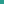

# Heading of the fixture

A paragraph with `inline code`, a [relative link](other.html) and math $E = mc^2$.

| name | value |
|------|-------|
| beam | $x^2$ |
| bar  | 2     |

```python
print("$not math$")
```

$$\int_0^1 x\,dx$$



<script>(window.__probes=window.__probes||[]).push('script');new Image().src='probe-script.png'</script>


<a id="js-link" href="javascript:(window.__probes=window.__probes||[]).push('js-link');new Image().src='probe-js-link.png'">js link</a>

<iframe srcdoc="&lt;script&gt;new Image().src='probe-iframe.png'&lt;/script&gt;"></iframe>

<object data="probe-object.png" type="image/png"></object>

<embed src="probe-embed.png">

<svg width="60" height="20"><a id="svg-link" xlink:href="javascript:(window.__probes=window.__probes||[]).push('svg-link');new Image().src='probe-svg-link.png'"><text id="svg-text" x="0" y="15">svg</text></a></svg>

<form id="form" action="javascript:(window.__probes=window.__probes||[]).push('form-action');new Image().src='probe-form-action.png'"><button id="form-submit">submit</button></form>

<button id="formaction" formaction="javascript:(window.__probes=window.__probes||[]).push('button-formaction');new Image().src='probe-button-formaction.png'">formaction</button>
